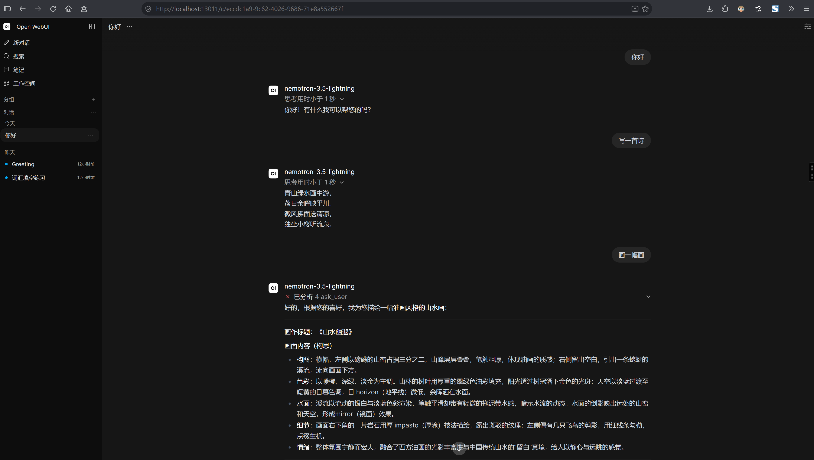
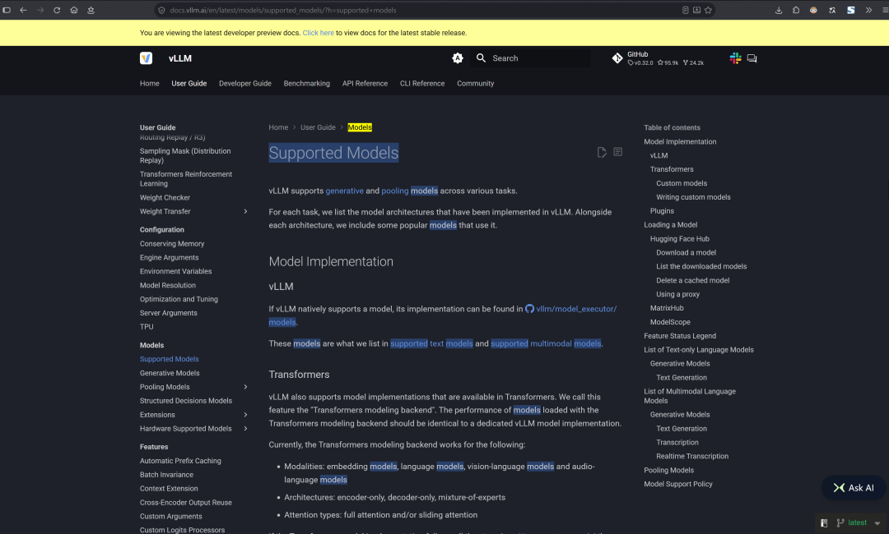
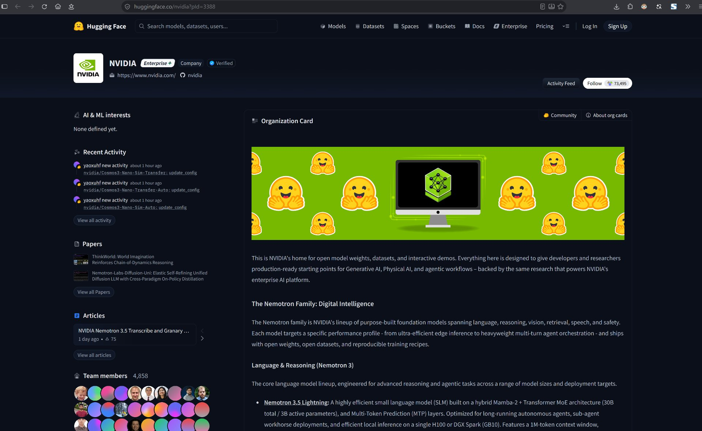
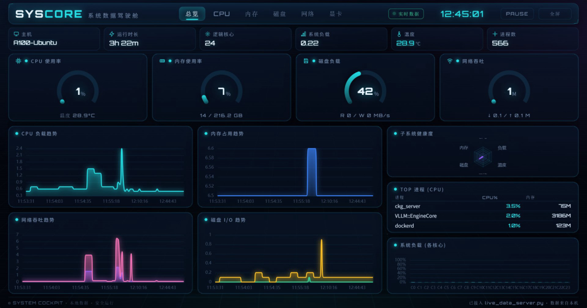
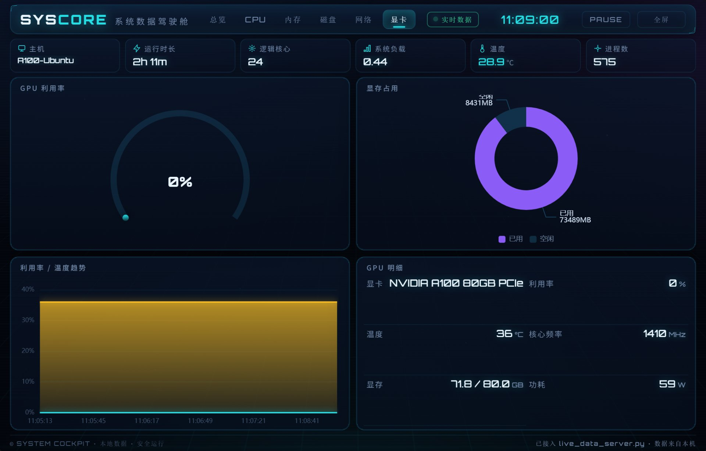

# Nemotron-3.5-Lightning 在 Docker + vLLM 上的部署记录

在单卡 **NVIDIA A100 80GB (Ampere)** 上，用官方 `vllm/vllm-openai` 镜像跑通 `nvidia/NVIDIA-Nemotron-3.5-Lightning-30B-A3B-NVFP4`（30B 总 / 3B 激活，hybrid Mamba-2 + MoE + Attention）。

> 本文所有命令均在本机（Ubuntu 24.04，Docker 29.1.3 + nvidia-container-toolkit 1.20，CUDA 13.2）实测通过。

## 架构概览

```
┌────────────────────────────────────────────────────────────────────────┐
│  Host: 1× NVIDIA A100 80GB (Ampere) · Ubuntu 24.04 · Docker 29          │
│                                                                          │
│   ┌────────────────────────────────────────────────────────────────┐   │
│   │  Container: vllm/vllm-openai:v0.27.1  (ENTRYPOINT: vllm serve)  │   │
│   │  Model: NVIDIA-Nemotron-3.5-Lightning-30B-A3B-NVFP4 (NVFP4)     │   │
│   │  OpenAI-compatible API :8000 · served: nemotron-3.5-lightning   │   │
│   └───────────────────────────────────┬────────────────────────────┘   │
│                                        │  http://nemotron35:8000/v1     │
│            ┌───────────────────────────┼───────────────────────┐         │
│            ▼                           ▼                       ▼         │
│     Open-WebUI (:13011)        Dify (Model Provider)     curl / OpenAI SDK│
└────────────────────────────────────────────────────────────────────────┘
```

## 目录导航

- 0. 项目结构
- 1. 环境约束
- 2. 步骤（下载权重 / 启动服务 / 验收）
- 3. 使用注意
- 4. 运维
- 5. 关键坑位速查
- 6. 接入前端（Open-WebUI / Dify）
- 7. 存活探测（healthcheck）
- 8. 运行效果

---

## 0. 项目结构

```
nemotron35-vllm/
├── README.md            # 本文件：部署记录与坑位速查
├── docker-compose.yml   # 一键起服务（等价于 scripts/serve.sh）
└── scripts/
    ├── download.sh      # 用容器内 hf CLI 从 hf-mirror 下载 NVFP4 权重
    └── serve.sh         # 启动 vLLM 推理服务（单卡 A100 适配）
```

快速流程：

```bash
bash scripts/download.sh          # 1) 下载权重（约 21GB）
docker compose up -d              # 2) 启动服务
curl http://localhost:8000/v1/models   # 3) 验收
```

> 权重默认目录：`/home/azureuser/models/nemotron-3.5-lightning-nvfp4`，可被
> `MODEL_DIR=/path/to/weights bash scripts/serve.sh` 或 compose 的卷挂载覆盖。

---

## 1. 环境约束（重要）

| 项 | 说明 |
|---|---|
| GPU | 1× A100 80GB（Ampere）。本模型/H100 专属优化**不可用**：`--moe-backend humming`、`--linear-backend humming`、`--mamba-ssu-algorithm horizontal`、`--async-scheduling` 组合。A100 回落默认/Marlin 后端，无 Hopper 的 ~20% 吞吐增益。 |
| 权重精度 | 官方仅发布 **BF16** 与 **NVFP4** 两版（无 FP8 权重；FP8 仅用于 KV cache）。选 NVFP4：权重 ~21.6GB，显存压力小，可开长上下文。 |
| 显存实测 | 服务启动后占用约 **73 / 80 GB**（`--gpu-memory-utilization 0.90`，KV cache 自动 fp8_e4m3，上下文 131072）。 |
| 网络 | `huggingface.co` / `registry-1.docker.io` **直连超时**；可用 `hf-mirror.com` 下载权重，Docker 已配 daocloud/1ms/dockerproxy 镜像源拉镜像。 |
| 本机工具 | 无 root、无 pip/`python -m pip`。**不要**在本机装 `huggingface_hub`，直接用**容器内自带的 `hf` CLI** 下载权重。 |

---

## 2. 步骤

### 2.1 拉取镜像（走已配置的 registry 镜像源）

```bash
docker pull vllm/vllm-openai:v0.27.1
```

> 该镜像 ENTRYPOINT 固定为 `["vllm", "serve"]`，因此**不要再写 `serve` 子命令**，模型路径作为**位置参数**传入。

### 2.2 下载权重（用容器内的 `hf`，走 hf-mirror）

```bash
mkdir -p /home/azureuser/models
docker run -d --name nemotron-dl --network=host --entrypoint bash \
  -v /home/azureuser/models:/models \
  -e HF_ENDPOINT=https://hf-mirror.com \
  -e HF_XET_HIGH_PERFORMANCE=1 \
  vllm/vllm-openai:v0.27.1 -c \
  'hf download nvidia/NVIDIA-Nemotron-3.5-Lightning-30B-A3B-NVFP4 \
     --local-dir /models/nemotron-3.5-lightning-nvfp4'

# 监控进度
docker logs -f nemotron-dl
du -sh /home/azureuser/models/nemotron-3.5-lightning-nvfp4
```

下载完成后权限释放：`docker rm -f nemotron-dl`。权重约 21GB（52 个 `*.safetensors` + config/tokenizer），确认 `config.json` 中 `architectures: ["NemotronHForCausalLM"]`。

### 2.3 启动推理服务

```bash
docker run -d --name nemotron35 \
  --gpus all --ipc=host --shm-size=16g \
  -p 8000:8000 \
  -v /home/azureuser/models/nemotron-3.5-lightning-nvfp4:/models/nemotron:ro \
  vllm/vllm-openai:v0.27.1 \
  /models/nemotron \
  --served-model-name nemotron-3.5-lightning \
  --trust-remote-code \
  --max-model-len 131072 \
  --gpu-memory-utilization 0.90 \
  --max-num-seqs 32 \
  --max-num-batched-tokens 16384 \
  --enable-prefix-caching \
  --mamba-backend flashinfer \
  --mamba-cache-mode align \
  --mamba-ssm-cache-dtype float16 \
  --reasoning-parser nemotron_v3 \
  --tool-call-parser qwen3_coder \
  --enable-auto-tool-choice \
  --host 0.0.0.0 --port 8000
```

### 2.4 等待与验收

```bash
# 等待 "Application startup complete" / 端口监听
docker logs -f nemotron35
ss -ltn | grep ':8000'

# 列表
curl http://localhost:8000/v1/models

# 一次带推理的请求（注意预留 max_tokens，见 §3）
curl http://localhost:8000/v1/chat/completions \
  -H 'Content-Type: application/json' \
  -d '{"model":"nemotron-3.5-lightning","messages":[{"role":"user","content":"What is 17*23? Give the number then a brief explanation."}],"max_tokens":4096,"temperature":0.2}'
```

预期：先返回 `reasoning`（思维链），再返回 `content`（如 `391. The product is found by calculating (17 × 20) + (17 × 3) = 340 + 51 = 391.`）。

---

## 3. 使用注意

1. **默认开启长思维链（reasoning）**：一次简单问题 reasoning 可达 ~1900 token。务必把 `max_tokens` 设够（建议 ≥2048）；否则 `finish_reason=length` 时 `content` 可能为空。需要关闭/限制推理预算时，按 NVIDIA 文档在请求级 `reasoning` 参数配置。
2. **A100 兼容**：自动使用 fp8 KV cache、`flashinfer` Mamba SSU（`auto`），无需也不应使用 Hopper 专属后端。
3. **上下文**：当前 `max-model-len 131072` 在 80GB 上稳定运行；若要 256K，需下调 `--max-num-seqs` 并实测显存。
4. **最大吞吐**：官方建议「最大吞吐 → 不开投机解码」；如需更低延迟可加 MTP/DFlash/DSpark（需额外草稿模型权重）。

---

## 4. 运维

```bash
docker logs -f nemotron35                       # 日志
docker stop nemotron35 / docker start nemotron35 # 停止 / 启动
docker rm -f nemotron35                         # 删容器（权重在 ~/models 下，重启用 §2.3 同条命令即可）
nvidia-smi                                      # 显存占用核对
```

端点：`http://localhost:8000/v1`，模型名 `nemotron-3.5-lightning`，OpenAI 兼容。

---

## 5. 关键坑位速查

| 现象 | 原因 | 解决 |
|---|---|---|
| `vllm: error: unrecognized arguments: serve` | 镜像 ENTRYPOINT 已是 `vllm serve`，又写了一次 | 命令里去掉 `serve`，模型只用位置参数 |
| `unrecognized arguments: /models/nemotron`（用 `--model`） | 该版本 `serve` 用位置参数传模型 | 改成位置参数 `/models/nemotron`，删掉 `--model` |
| 本机 `pip` / `hf` / `python -m pip` 均不存在 | 无 root、无 pip | 用容器内 `hf` CLI 下载权重 |
| 直连 HF 超时 | 网络限制 | `HF_ENDPOINT=https://hf-mirror.com` |
| 返回 `content` 为空 | reasoning 占满 token 预算 | 加大 `max_tokens` 或限制推理预算 |

---

## 6. 接入本机已运行的前端（Open-WebUI / Dify）

将 vLLM 容器接入它们所在的 Docker 网络，即可用容器名 `nemotron35:8000` 互通（已在当前运行实例上连通并验证）：

```bash
docker network connect nocobase-ai_default nemotron35   # Open-WebUI 所在网络
docker network connect aicomic-dify_default nemotron35   # Dify-api 所在网络
```

接入后，两个前端的统一端点为：

```
Base URL : http://nemotron35:8000/v1
模型名   : nemotron-3.5-lightning
API Key  : 任意（如 sk-nemotron，vLLM 不校验）
```

### Open-WebUI
Settings → Admin Settings → Connections → OpenAI API：URL 填 `http://nemotron35:8000/v1`，Key 任意。保存后模型下拉即出现 `nemotron-3.5-lightning`。

### Dify
Settings → Model Provider → OpenAI（或 OpenAI-API-compatible）→ 添加：
API Base `http://nemotron35:8000/v1`、Model `nemotron-3.5-lightning`、Key 任意。保存后在 App 的模型选择器直接选用。

> **持久化**：若用 `docker compose up` 重建容器，compose 已声明上述 external 网络（见 `docker-compose.yml` 的 `networks` 段），无需重跑 `docker network connect`；若用 `scripts/serve.sh` 手动起容器，则重建后需再跑一次上面的两条 `docker network connect`。

---

## 7. 存活探测（healthcheck）

`scripts/healthcheck.sh` 检查 `/health` 与 `/v1/models`，可选做一次轻量推理；退出码 `0`=健康、`1`=异常，可接 cron / 监控告警。

```bash
bash scripts/healthcheck.sh                              # 单次探测 http://localhost:8000
VLLM_URL=http://nemotron35:8000 bash scripts/healthcheck.sh   # 从其他容器网络探测
INTERVAL=30 bash scripts/healthcheck.sh                 # 每 30s 循环（Ctrl-C 退出）
CHECK_INFER=1 bash scripts/healthcheck.sh               # 额外做一次推理探测
```

环境变量：`VLLM_URL`（默认 `http://localhost:8000`）、`INTERVAL`、`CHECK_MODELS`（默认 1）、`CHECK_INFER`（默认 0）、`MODEL_NAME`（默认 `nemotron-3.5-lightning`）。

---

## 8. 运行效果

### Open-WebUI 对话（模型已在列表中，reasoning 正常分离）



> 截图中模型名 `nemotron-3.5-lightning`，回复先展示「思考」再输出正文，验证了 `nemotron_v3` 推理解析链路正常。

### vLLM 官方 Supported Models 文档（hybrid MoE 架构由 vLLM 原生支持）



### 模型来源：HuggingFace NVIDIA 官方组织页（Nemotron 3.5 Lightning：30B 总 / 3B 激活，hybrid Mamba-2 + MoE，1M 上下文）



### 运行监控：SYS CORE 总览页（CPU / 内存 / 磁盘 / 网络，服务常驻）



### 运行监控：SYS CORE 显卡页（A100 80GB，显存 71.8 / 80.0 GB，服务常驻约 73GB）


